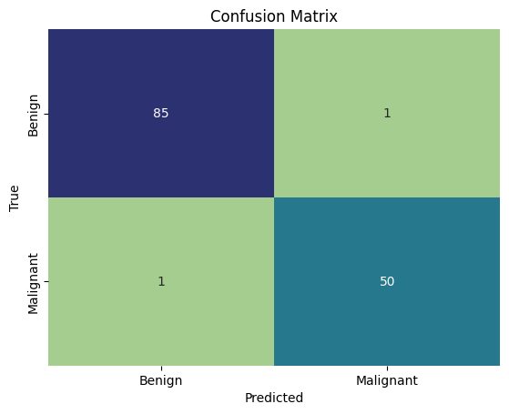

## Introduction

In this project, we develop an Artificial Neural Network (ANN) model for breast cancer classification based on the classic Wisconsin Breast Cancer dataset.

The model classifies tumors into two diagnostic categories:
- **`2` = Benign** (non-cancerous)
- **`4` = Malignant** (cancerous)

The dataset contains 11 columns and 683 patient records collected from clinical fine needle aspirate (FNA) biopsies.

---

## Importing the libraries

We begin by loading the essential Python libraries for data processing, deep learning with TensorFlow / Keras, and visualization.

```python
import pandas as pd
import numpy as np
import tensorflow as tf
import matplotlib.pyplot as plt
import seaborn as sns
```

---

## Importing the dataset

Next, we load the dataset from `Data.csv`.

```python
dataset = pd.read_csv('Data.csv')
```

---

## Check the Data

Let's inspect the first few rows of the dataset to examine the feature space:

```python
dataset.head()
```

```
   Sample code number  Clump Thickness  Uniformity of Cell Size  \
0             1000025                5                        1   
1             1002945                5                        4   
2             1015425                3                        1   
3             1016277                6                        8   
4             1017023                4                        1   

   Uniformity of Cell Shape  Marginal Adhesion  Single Epithelial Cell Size  \
0                         1                  1                            2   
1                         4                  5                            7   
2                         1                  1                            2   
3                         8                  1                            3   
4                         1                  3                            2   

   Bare Nuclei  Bland Chromatin  Normal Nucleoli  Mitoses  Class  
0            1                3                1        1      2  
1           10                3                2        1      2  
2            2                3                1        1      2  
3            4                3                7        1      2  
4            1                3                1        1      2  
```

Let's check the data types and verify that there are no missing values:

```python
dataset.info()
```

```
<class 'pandas.core.frame.DataFrame'>
RangeIndex: 683 entries, 0 to 682
Data columns (total 11 columns):
 #   Column                       Non-Null Count  Dtype
---  ------                       --------------  -----
 0   Sample code number           683 non-null    int64
 1   Clump Thickness              683 non-null    int64
 2   Uniformity of Cell Size      683 non-null    int64
 3   Uniformity of Cell Shape     683 non-null    int64
 4   Marginal Adhesion            683 non-null    int64
 5   Single Epithelial Cell Size  683 non-null    int64
 6   Bare Nuclei                  683 non-null    int64
 7   Bland Chromatin              683 non-null    int64
 8   Normal Nucleoli              683 non-null    int64
 9   Mitoses                      683 non-null    int64
 10  Class                        683 non-null    int64
dtypes: int64(11)
memory usage: 58.8 KB
```

```python
dataset.isnull().sum()
```

```
Sample code number             0
Clump Thickness                0
Uniformity of Cell Size        0
Uniformity of Cell Shape       0
Marginal Adhesion              0
Single Epithelial Cell Size    0
Bare Nuclei                    0
Bland Chromatin                0
Normal Nucleoli                0
Mitoses                        0
Class                          0
dtype: int64
```

There are zero missing values across all 683 instances.

---

## Transform Data

We separate our features `X` (excluding the ID column `Sample code number` and target column `Class`) and target variable `y`.

To prepare for binary classification in neural networks, we encode the labels:
- **`0`** for Benign (`Class == 2`)
- **`1`** for Malignant (`Class == 4`)

```python
X = dataset.iloc[:, 1:-1].values
y = dataset.iloc[:, -1].values

y = np.where(y == 2, 0, 1)
```

---

## Splitting the dataset into the Training set and Test set

We perform an 80/20 train-test split, reserving 20% of the data (137 samples) to evaluate generalizability:

```python
from sklearn.model_selection import train_test_split
X_train, X_test, y_train, y_test = train_test_split(X, y, test_size=0.2, random_state=11)
```

---

## Feature Scaling the Dataset

Neural networks use gradient descent optimization, which converges much faster and more reliably when all input features are on a standardized scale. We apply `StandardScaler` (Z-score normalization) fit exclusively on the training set:

```python
from sklearn.preprocessing import StandardScaler
sc = StandardScaler()
X_train = sc.fit_transform(X_train)
X_test = sc.transform(X_test)
```

---

## Building ANN Model

We build a feed-forward sequential neural network using TensorFlow / Keras.

```python
ann = tf.keras.models.Sequential()
```

### Adding first hidden layer
The first hidden layer consists of 8 neurons with the Rectified Linear Unit (`relu`) activation function:

```python
ann.add(tf.keras.layers.Dense(units=8, activation='relu'))
```

### Adding second hidden layer
We add a second dense layer with 8 neurons and `relu` activation to capture non-linear feature interactions:

```python
ann.add(tf.keras.layers.Dense(units=8, activation='relu'))
```

### Adding output layer
For binary classification, our output layer consists of a single neuron with a `sigmoid` activation function, outputting a probability between 0 and 1:

```python
ann.add(tf.keras.layers.Dense(units=1, activation='sigmoid'))
```

---

## Compile the ANN Model

We compile the network using the `adam` optimizer and `binary_crossentropy` as our loss function, tracking classification `accuracy`:

```python
ann.compile(optimizer='adam', loss='binary_crossentropy', metrics=['accuracy'])
```

---

## Training the ANN Model

We train the model on `X_train` with a batch size of 32 over 100 epochs:

```python
ann.fit(X_train, y_train, batch_size=32, epochs=100)
```

```
Epoch 1/100
18/18 [==============================] - 2s 5ms/step - accuracy: 0.1076 - loss: 0.7738
Epoch 2/100
18/18 [==============================] - 0s 5ms/step - accuracy: 0.2668 - loss: 0.7041
Epoch 3/100
18/18 [==============================] - 0s 5ms/step - accuracy: 0.5978 - loss: 0.6490
Epoch 4/100
18/18 [==============================] - 0s 5ms/step - accuracy: 0.7442 - loss: 0.6170
...
Epoch 100/100
18/18 [==============================] - 0s 5ms/step - accuracy: 0.9780 - loss: 0.0521
```

Over 100 epochs, the training loss decreases steadily while training accuracy reaches ~97.8%.

---

## Evaluating the Model with Confusion Matrix

Finally, we evaluate the trained ANN on our held-out test set (`X_test`). We convert predicted probabilities to binary class predictions using a decision threshold of 0.5, and compute the test accuracy and confusion matrix:

```python
from sklearn.metrics import confusion_matrix, accuracy_score

y_pred = ann.predict(X_test)
y_pred = (y_pred > 0.5)
cm = confusion_matrix(y_test, y_pred)

accuracy = accuracy_score(y_test, y_pred)
print('accuracy of model : {:.2f}%'.format(accuracy * 100))

sns.heatmap(cm, annot=True, cmap="crest", cbar=False, 
            xticklabels=['Benign', 'Malignant'], 
            yticklabels=['Benign', 'Malignant'])
plt.title('Confusion Matrix')
plt.xlabel('Predicted')
plt.ylabel('True')
plt.show()
```

```
accuracy of model : 98.54%
```

{fig-align="center" width="75%"}

### Evaluation Highlights:
- **Test Accuracy:** The model achieves **98.54% accuracy** on unseen test data (135 out of 137 correctly diagnosed).
- **Confusion Matrix Breakdown:**
  - True Benign correctly predicted: **85 / 86** (only 1 false positive).
  - True Malignant correctly predicted: **50 / 51** (only 1 false negative).
- In medical diagnostics, minimizing false negatives (misclassifying malignant tumors as benign) is critical, and the network demonstrates exceptional sensitivity on this benchmark.
